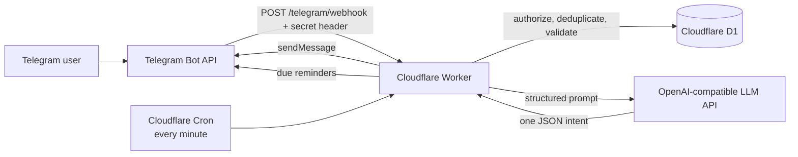

# Hermes Mini Cloud

> A serverless Persian Telegram assistant that turns free-form messages into safe task actions and reliable reminders.

`Hermes Mini Cloud` is a Cloud Computing course project built on Cloudflare Workers and D1. It has no always-on server, no Docker container, and no slash-command interface: users write naturally in Persian and the assistant decides what they mean, while application code remains responsible for every security-sensitive decision.

## What the user experiences

| You write in Persian | Hermes does |
| --- | --- |
| `برای خرید شیر یک کار بساز` | Adds a task |
| `کارهای من چیه؟` | Lists open tasks |
| `شیر را خریدم` | Marks the matching task done |
| `همه کارها را حذف کن` | Asks for explicit confirmation first |
| `ده دقیقه دیگه یادم بنداز به مامان زنگ بزنم` | Creates a persistent reminder |
| `سلام، حالت چطوره؟` | Replies conversationally in Persian |

There are no `/add`, `/list`, or other slash commands. The language model proposes one structured intent; the Worker validates it and decides whether it is safe to execute.

## Final scope

- Free-form Persian task management: `add`, `done`, `undone`, `del`, `list`, and `chat`
- Per-user conversation memory stored in D1
- Multi-user D1 allow-list; unauthorized users are silently ignored
- Secure Telegram webhook with a secret header and constant-time comparison
- Idempotent update processing so Telegram redelivery cannot duplicate work
- Safe clarification flow for ambiguous task references
- Persistent relative-time reminders, delivered by a Cloudflare Cron Trigger
- Tehran-aware date context for the LLM and reminder confirmation times
- TypeScript regression tests for the two highest-risk areas: ambiguous mutations and reminder delivery

Voice transcription was intentionally reverted from `main`; it is not part of the final supported feature set.

## Architecture



### Why these choices?

| Decision | Reason |
| --- | --- |
| Webhook, not polling | The Worker runs only when Telegram sends an update; it does not keep a process alive asking for new messages. |
| Serverless / FaaS | The workload is short and event-driven, so Workers remove server maintenance and fit the course free-plan constraint. |
| D1, not KV | Tasks, history, confirmations, authorizations, and reminders need relational queries, ordering, indexes, and transactions. |
| D1 for state | A Worker is stateless between requests. Persistent state therefore belongs in the database, not memory. |
| LLM proposes; code executes | Language understanding is useful, but the model never receives direct database authority. |

## Message lifecycle

1. Telegram calls `POST /telegram/webhook` with its shared secret header.
2. The Worker rejects a missing or invalid secret with `403`.
3. It accepts only private messages from active entries in `authorized_users`.
4. `processed_updates` atomically claims the Telegram `update_id`, preventing duplicate processing.
5. The Worker checks pending deletion confirmations and pending task clarifications first.
6. It loads the user's recent history and owned task candidates, then requests one JSON intent from the LLM.
7. The JSON is parsed and validated. Invalid output produces a safe Persian fallback with no database write.
8. Valid actions use parameterized D1 queries, then the Worker stores the exchange and replies through Telegram.

## Safety model

### The model suggests; the Worker decides

The LLM can only return one action from a fixed allow-list. It cannot run SQL, call Telegram, choose an arbitrary URL, or bypass ownership checks. In particular:

- A malformed JSON response causes no state change.
- Every task mutation is re-scoped to `telegram_user_id` in SQL.
- A model-provided `task_id` never authorizes a mutation by itself.
- The user's wording must deterministically identify a unique title or a number actually shown in a recent task list.
- Ambiguity creates a 10-minute, per-user clarification snapshot. The next answer is resolved in code against that snapshot, not sent back to the LLM as a new instruction.
- Deleting all tasks always requires an explicit Persian confirmation; a cancellation or unrelated reply aborts it.

### Webhook and data security

- `X-Telegram-Bot-Api-Secret-Token` is verified with a constant-time comparison.
- Only active D1 allow-list entries are processed. Unauthorized messages receive no reply and create no stored data.
- All queries use bound parameters.
- Secret values never belong in the repository or `wrangler.jsonc`.
- Error logging records only error identity, never secrets or message text.

## Reminder reliability

The `remind` intent supports explicit relative Persian durations such as `دو دقیقه دیگه` or `یک ساعت و 30 دقیقه دیگه`.

- Duration parsing is deterministic in Worker code; the model's claimed delay is not trusted.
- The reminder stores a UTC Unix timestamp in D1, then its confirmation shows the approximate Tehran time.
- A `* * * * *` Cron Trigger scans up to 20 due reminders per invocation.
- A compare-and-set claim prevents two Cron executions from sending the same reminder concurrently.
- A failed Telegram delivery retries with linear backoff. After five failures, the reminder is marked `failed` instead of retrying forever.
- Claims abandoned for more than 16 minutes are recovered safely and count toward that bounded retry budget.
- A reminder for a revoked user is cancelled without a Telegram call.

## Technology stack

| Component | Purpose |
| --- | --- |
| Cloudflare Workers | Serverless TypeScript runtime and webhook endpoint |
| Cloudflare D1 | Persistent SQLite database |
| Cloudflare Cron Triggers | Scheduled reminder delivery |
| Telegram Bot API | User interface, webhook source, and response delivery |
| OpenAI-compatible Chat Completions API | Persian language understanding and conversational replies |
| Wrangler | Cloudflare deployment and D1 migration CLI |
| Node test runner + TypeScript | Regression testing and static type checking |

## Database model

| Table | Responsibility |
| --- | --- |
| `tasks` | User-owned tasks, completion state, optional date, and idempotent creation source |
| `conversation_messages` | Short per-user conversation memory; pruned to the newest 30 messages |
| `authorized_users` | Active Telegram-user allow-list |
| `processed_updates` | Telegram update deduplication |
| `pending_confirmations` | Expiring delete-all confirmations |
| `pending_clarifications` | Expiring deterministic snapshots for ambiguous task actions |
| `reminders` | Scheduled reminder lifecycle, claims, retries, and delivery state |

Schema changes are versioned in `migrations/`. Applied migration files are immutable: a new change always receives a new numbered file.

## Configuration

### Secrets

Set these in Cloudflare's secret store or with `wrangler secret put <NAME>`:

| Secret | Purpose |
| --- | --- |
| `TELEGRAM_BOT_TOKEN` | Sends replies through the Telegram Bot API |
| `TELEGRAM_WEBHOOK_SECRET` | Shared secret verified on each webhook request |
| `LLM_API_KEY` | Bearer credential for the configured LLM provider |

### Plain variables

The non-secret configuration lives in `wrangler.jsonc`:

| Variable | Purpose |
| --- | --- |
| `LLM_API_URL` | Full OpenAI-compatible Chat Completions endpoint |
| `LLM_MODEL` | Model identifier sent to the provider |

The D1 binding is named `DB`; the repository never contains secret values.

## Endpoints

| Method | Path | Result |
| --- | --- | --- |
| `GET` | `/` | Service metadata |
| `GET` | `/health` | Worker health JSON |
| `GET` | `/health/db` | D1 connectivity check; `503` if unavailable |
| `POST` | `/telegram/webhook` | Telegram update endpoint; `403` for a bad secret |

## Local quality checks

```powershell
# PowerShell may require the .cmd form when script execution is restricted.
npm.cmd test
npm.cmd run typecheck
```

The test suite covers deterministic clarification safety, cross-user isolation, retry-safe mutation, Persian duration parsing, reminder persistence, concurrent Cron claims, bounded retries, stale-claim recovery, and authorization changes.

## Deployment and migrations

```powershell
# Inspect or apply D1 migrations against the configured remote database.
npm.cmd run db:migrations:list:remote
npm.cmd run db:migrations:apply:remote

# Deploy the Worker when the Cloudflare project is configured.
npm.cmd run deploy
```

Set the Telegram webhook to the deployed Worker URL plus `/telegram/webhook`, using the exact same secret stored in `TELEGRAM_WEBHOOK_SECRET`.

## Project layout

```text
src/index.ts                         Worker, LLM contract, webhook, task and reminder logic
migrations/0001_initial_schema.sql   Tasks and conversation history
migrations/0002_telegram_runtime.sql Runtime security, authorization, and idempotency
migrations/0003_pending_clarifications.sql  Deterministic ambiguity handling
migrations/0004_reminders.sql        Reminder persistence and lifecycle
tests/clarification.test.ts          Mutation and clarification regression tests
tests/reminders.test.ts              Reminder delivery regression tests
wrangler.jsonc                       Worker, D1, Cron, and non-secret configuration
```

## Known boundaries

- Reminders intentionally accept explicit relative minutes or hours, not absolute calendar-time requests.
- Cron delivery has minute-level scheduling granularity, so a reminder is expected around its due minute rather than at sub-minute precision.
- The system is deliberately an allow-listed personal assistant, not a public multi-tenant Telegram bot.
- The LLM is an interpretation layer, not a source of truth; every state-changing decision is constrained by application code.

---

Built for the Cloud Computing course - focused on observable serverless design, safe LLM integration, and reliable state management.
